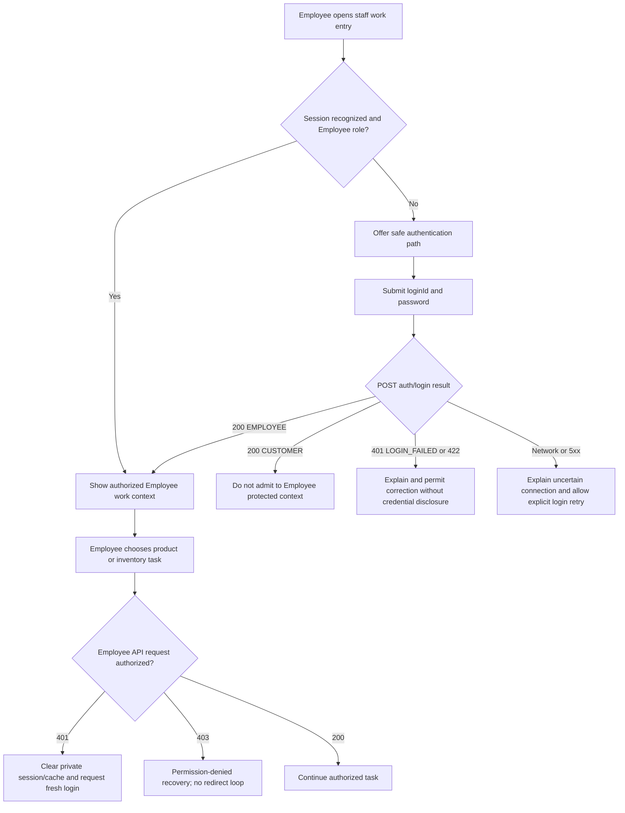
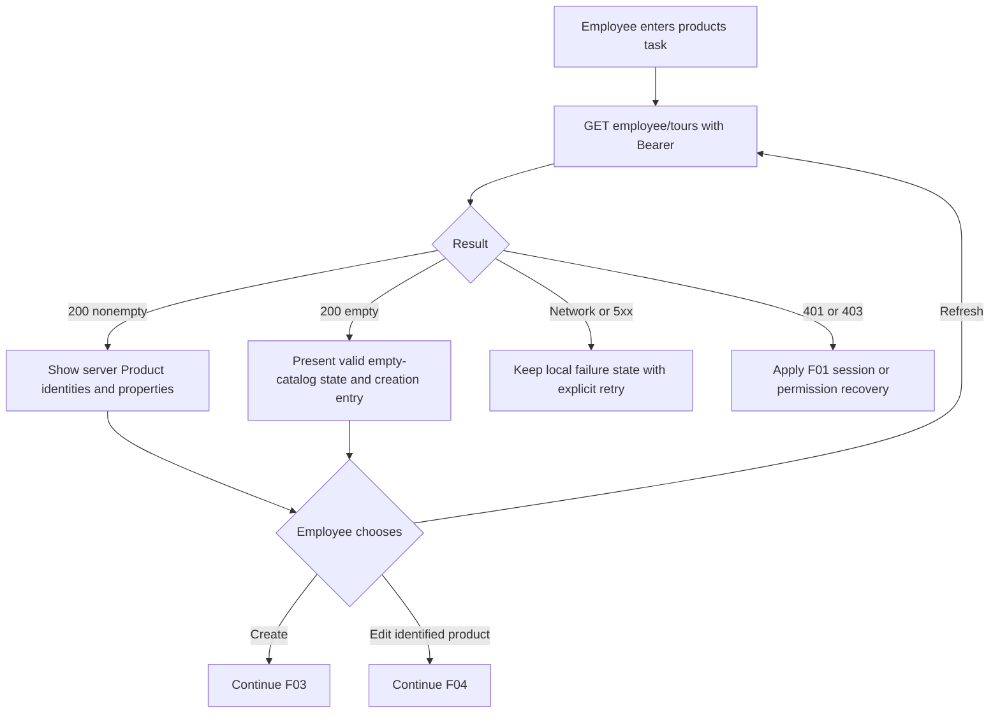
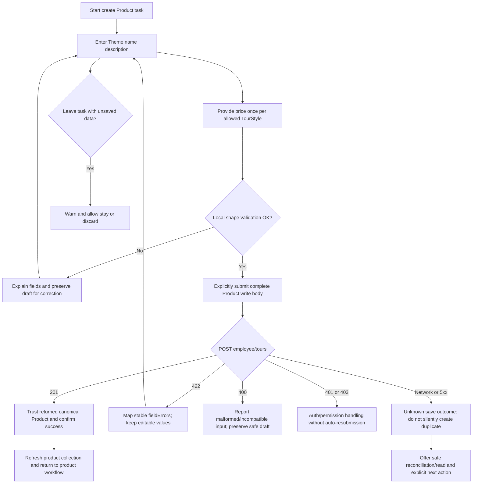
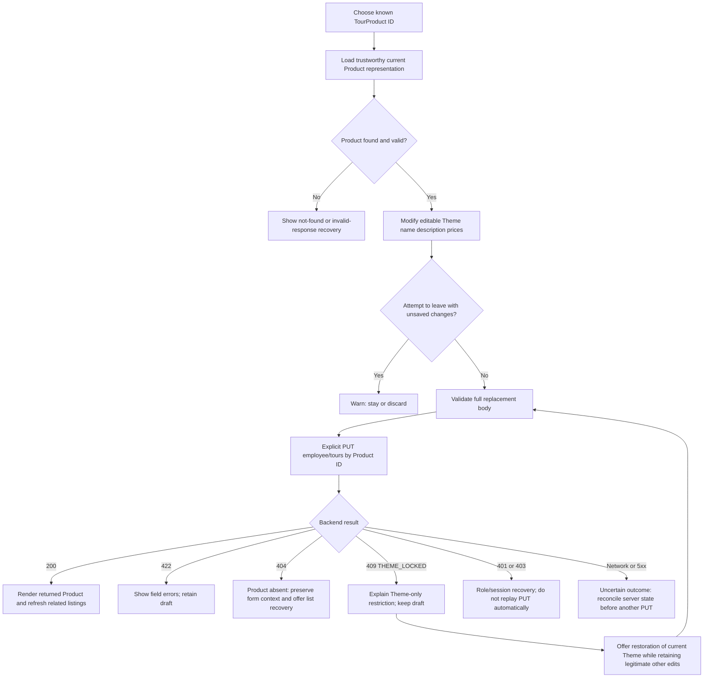
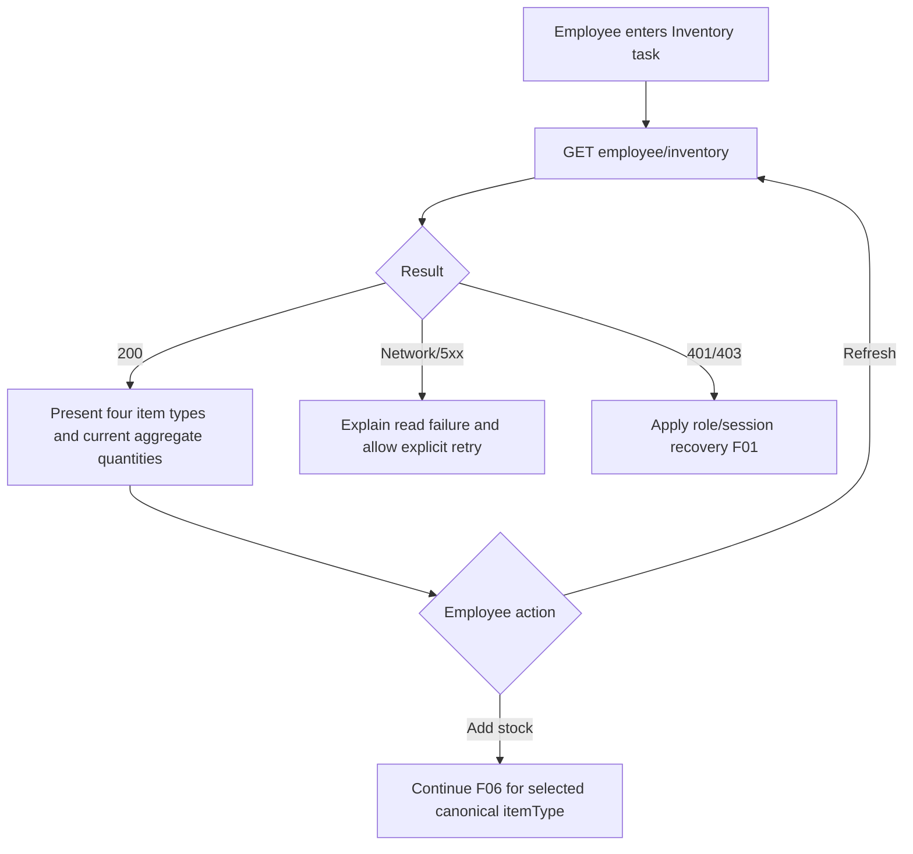
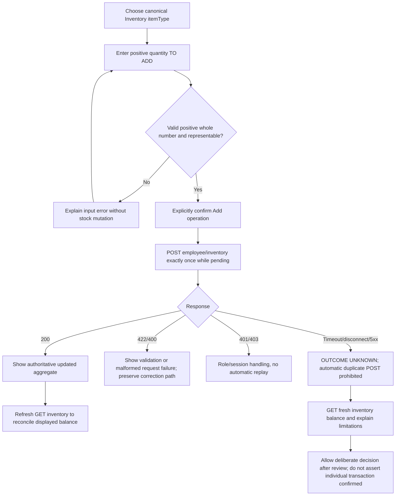
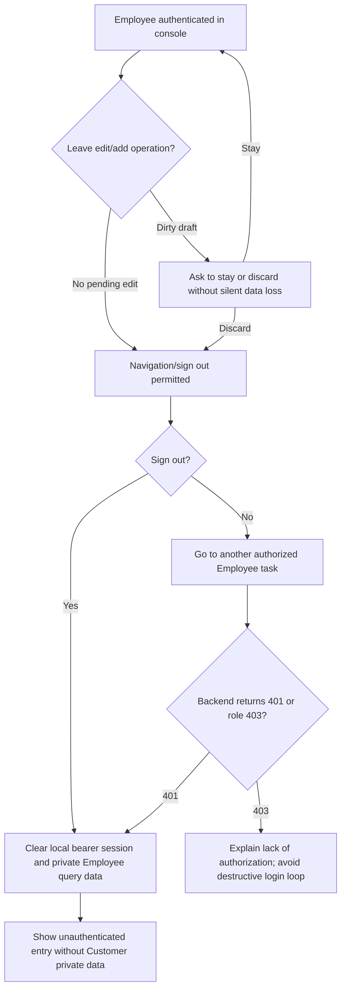

# CP1-A — Employee Operator Tasks and End-to-End Task Flows

> **Status: DRAFT / DEPENDENT; CP0 review-and-merge gate is NOT yet complete.** This document is not an approved Employee IA, visual design, route table or screen specification.
> Authored 2026-10-13 (Asia/Seoul), owner 김태우 / `WonhoOne/frontend`.
> Source chain: P0 program [#45 MERGED](https://github.com/WonhoOne/frontend/pull/45) → [CP0-A #46](https://github.com/WonhoOne/frontend/pull/46) → [CP0-B #47](https://github.com/WonhoOne/frontend/pull/47) → [CP0-C #48](https://github.com/WonhoOne/frontend/pull/48) → **this CP1-A dependent draft**.
> **OWNER-APPROVED CP0-C DEC-C01: A — PC-only web Employee Console.** Tablet/phone not support acceptance targets. No further device vote is needed.
> Contracts frozen for this **source audit**: [docs/main `f49d045`](https://github.com/WonhoOne/docs/commit/f49d0457498e8b775f659a27e0c3a96d288d0ba0), [Backend/main `597cf92`](https://github.com/WonhoOne/backend/commit/597cf92f1baf93211862d4ea5dbfa8a199b808a2), [Frontend/main `fa84f4b`](https://github.com/WonhoOne/frontend/commit/fa84f4b578a3969213bfc851d5b4fa8121ead66d).
> Upstream required reading: [CP0-A](CP0-A-FRONTEND-RUNTIME-INVENTORY.md), [CP0-B](CP0-B-BACKEND-EMPLOYEE-CONTRACT-AUDIT.md), [CP0-C](CP0-C-SCOPE-DEVICE-DEMO-GATE.md) and [progress ledger](../01-PROGRESS-AND-HANDOFF.md).

## 1. Objective — what is being decided at CP1-A?

Describe **what an Employee needs to accomplish, in what order, and how each task terminates or recovers**, separately from **where the controls/screens/routes will be placed**. The latter is **CP1-B** and must not be silently decided here.

Focus on the university assignment's Employee requirements and the approved shared v0.2 contract:

- FR-01: Employee authentication with a Backend-provisioned `EMPLOYEE` account, no public Employee signup.
- FR-10: list, create and update TourProduct. Write includes exactly `theme,name,description,stylePrices`; `availableStyles` is read-only derived output.
- FR-11: read four fixed inventory item types and add **positive quantity delta**; no inventory decrease/replace/delete or reservation auto-deduction.
- BR-31: if any TourSchedule is linked, changing to a **different** Theme is forbidden with `409 TOUR_PRODUCT_THEME_LOCKED`; same-Theme edit remains possible.
- CP0-C approval: **PC-only**, keyboard and accessibility within the supported desktop environment.
- NFR-02/03/06: accurate persistence and complete Employee tasks need real-backend acceptance and tests during P2; task-flow document alone cannot certify them.

**Design mode:** each flow distinguishes `CONTRACT GUARANTEE` from `FRONTEND-LOCAL UX PROPOSAL` and `TBD FOR NEXT CP`. No new API or business rule is authorized. This is a **task-flow hypothesis** for review, not a visual wireframe or finalized architecture.

## 2. Employee task map and completion criteria

| Task ID | Employee's intention | Trigger/preconditions | Observable successful end state | Failure/recovery obligation |
| --- | --- | --- | --- | --- |
| **T01** | Sign in to do staff work | Backend-provisioned account; anonymous or needing reauth | `EMPLOYEE` login result and access to authorized Employee work, without Customer-specific history/voice behavior | Invalid credentials, expired/missing token and wrong role distinct; no private data leaked |
| **T02** | Find/inspect existing TourProduct | Employee session valid | Server-backed list of ID-ordered Products, select exact product identity; empty is valid | List initial failure, stale refresh, signed-out or forbidden state |
| **T03** | Add a new TourProduct | Employee session valid and chosen Theme | Backend returns `201` with new positive product ID and valid Theme-dependent prices; collection can be refreshed | Field errors, invalid price style set, 401/403, unexpected/unknown save result |
| **T04** | Update a TourProduct | Employee session valid and *known existing* product | Backend returns `200` canonical Product; change is persisted | Unsaved edits, 422, 404, linked-Schedule Theme 409, uncertain response, 401/403 |
| **T05** | Check stock balance | Employee session valid | Server-backed four fixed ItemTypes with current non-negative quantities (zero is valid) | GET initial/refresh failure and role-state recovery |
| **T06** | Add stock to an existing item | Employee session valid; selected fixed `itemType`; positive amount | Backend returns `200` with updated aggregate; subsequent read can show current truth | Nonpositive amount, 400/422, ambiguous POST completion, concurrency, unsafe duplicate submit |
| **T07** | Leave Employee scope/sign out | Signed-in Employee | Session invalidated locally; private Employee queries not left exposed through UI/cache | Navigation after token invalidation, unsaved work warning, switching identities safely |

T07 is a necessary **Frontend session UX behavior**, not an approved REST logout endpoint. It must reuse/extend the existing local `signOut` mechanism (no Backend logout API). There is no extra account manager in scope.

## 3. End-to-end task flows

### Flow F01 — Staff sign-in + correct-role entry

**CONTRACT:** public `POST /api/v1/auth/login` accepts either role; `/api/v1/employee/**` requires Employee; 401 is missing/invalid/expired, 403 is authenticated wrong role. **CURRENT CODE FACT:** [auth.adapter.ts](../../../src/features/auth/auth.adapter.ts) rejects Employee; [LoginPage.tsx](../../../src/pages/login/LoginPage.tsx) currently redirects to Customer home and may trigger Previous Trips; [AppRouteLayout.tsx](../../../src/app/router/AppRouteLayout.tsx) mounts Customer chrome/popup/voice. CP7 must extend Auth model safely rather than silently changing a Customer-only test.

**UX PROPOSAL:** denied wrong-role identity gets a clear permission explanation and a safe route to appropriate context; do not imply an Employee public signup. Employee route revisits after auth preserve only **validated, role-appropriate navigation context**, not credentials or automatic rerun of interrupted mutations. **TBD CP1-B:** shared Login screen vs separate Employee entry, default landing, return/navigation rules.

### Flow F02 — Browse TourProducts and select a target

**CONTRACT:** `GET /employee/tours` returns a plain array in `id ASC`; product representation contains `id,theme,name,description,availableStyles,stylePrices`, not destination/photo/schedule count. There is **no Employee-specific GET by product ID**. **UX PROPOSAL:** listing should let the employee distinguish Products that share the same Theme without conflating a Theme with a Product. **TBD CP1-B/CP8:** whether edit data are taken from Employee list snapshot, refreshed list, or approved public `GET /tours/{tourId}`; how direct navigation with unknown ID recovers. No new Employee detail API may be assumed.

### Flow F03 — Create TourProduct

**CONTRACT:** `HONEYMOON_ROMANCE` and `PARENTS_HEALING` require `GRAND/PREMIUM`; `GOLF_CHALLENGE` and `OUTDOOR_TREKKING` require `CLASSIC/GRAND/PREMIUM`. All prices positive whole KRW, currency `KRW`; `name` nonblank <=255, `description` nonblank <=2000; request excludes response-only `availableStyles`. `POST` success is 201 complete Product; 422 `VALIDATION_FAILED` exposes structured `fieldErrors`. **UX PROPOSAL:** avoid losing draft when switching Theme or navigating away; detail of how to reconcile price fields when Theme changes is **CP6-C**, not decided here. **Network ambiguity:** client cannot infer a failed creation solely from missing response; avoid blind duplicate POST. **TBD CP5/CP8:** exact verification/duplicate detection strategy given no idempotency-key endpoint.

### Flow F04 — Edit TourProduct (including linked-Schedule lock)

**CONTRACT:** PUT is a **complete replacement of allowed Product fields**; one linked Schedule of any past/current/future/confirmed state forbids changing Theme; same-Theme name/description/price edits remain valid. The Backend response does **not** contain `themeLocked`, therefore lock cannot be proved from the Product representation alone; the actual PUT/409 remains authoritative. **UX PROPOSAL:** preserve employee edits on 409 and explain the difference between Theme change and allowable other edits; do **not** globally disable Product edits after a 409. **TBD CP1-B/CP5/CP6-D:** exact recovery affordance and whether schedule-link data need proactive read; choosing these is not CP1-A's scope.

### Flow F05 — Review fixed-item Inventory

**CONTRACT:** four fixed kinds `COUPLE_TSHIRT, GINSENG_GIFT, GOLF_BALL, SCARF`; quantity >=0; response plain array by ID ASC. Zero is a **valid current state**, not an empty catalog. **UX PROPOSAL:** display actual server quantities clearly distinct from input to *add* stock. Missing/corrupt expected fixed-item data are backend data-integrity errors, **not** permission to invent stock values client-side.

### Flow F06 — Add Inventory quantity (non-idempotent)

**CONTRACT:** request `{itemType,quantity}` where quantity is the **positive delta**, not replacement; success 200 returns updated `{id,itemType,quantity}`. Backend serializes same-row writes with DB locking; concurrency does not lose an add but **GET balance alone cannot reliably prove an individual timed-out request succeeded** if other operators also add stock. **CRITICAL:** there is **no idempotency key** in approved API. Retrying POST automatically after a timeout could apply another delta. Default QueryClient mutation retry is already zero; preserve this safety. Backend Java `long` permits integers beyond JS safe range; precise input/parse/render strategy belongs to CP8.

**UX PROPOSAL:** input label and confirmation explicitly say "추가할 수량", include item and addition amount; success displays new total. An uncertain result should never display a guessed successful increment. **TBD CP5-B/CP8-B:** precise copy, loading disabled state, reconcile UX and whether to ask operator/backend for manual verification.

### Flow F07 — Switch task / sign out / identity transition

**CONTRACT:** v0.2 has no logout REST API; JWT is bearer until expiry. **CURRENT FRONTEND:** AuthProvider has `signOut`, memory-only session storage, `clearPrivateQueryCache` on auth loss; role expansion must not reuse a Customer `ReservationDraft` or Customer Previous Trips popup as Employee data. **UX PROPOSAL:** safe navigation guard for unsaved Product edits. **DO NOT** persist Employee passwords, access tokens or sensitive form state in navigation/query parameters.

## 4. Cross-flow exception and safety table

| Interruption | Consistent business truth | Proposed frontend recovery | Later specification |
| --- | --- | --- | --- |
| Before Employee login | no private Employee reads | require login or show role-appropriate entry | CP1-B / CP6-A |
| Logged-in CUSTOMER opening Employee area | Backend 403 `FORBIDDEN` on protected endpoints | do not expose Employee server data; show wrong-role explanation | CP1-B / CP6-A |
| Employee loses token while reading | 401; token no longer valid | clear private data; safe login return path | CP5 / CP7 / CP8 |
| Employee loses token while submitting Product PUT | 401 or unknown request completion | preserve safe draft; do not automatically replay mutation | CP5-B / CP6-D |
| Product list is empty | GET 200 `[]` | valid empty state with creation entry | CP6-B |
| Product ID invalid/not found | invalid path 400 or missing 404; no Employee detail endpoint | safe error and list recovery; no invented record | CP1-B / CP6-D |
| Changing Theme changes legal Style set | complete allowed set required for requested Theme | review/reconcile entered prices, no hidden disallowed style silently submitted | CP6-C/D |
| Any Schedule linked, Theme changed | 409 `TOUR_PRODUCT_THEME_LOCKED` | keep form; explain why only Theme is blocked | CP5 / CP6-D |
| Validation errors | 422 fieldErrors array of stable paths/codes | map errors to correct fields; keep inputs | CP6/CP8 |
| Inventory zero | valid balance 0 | show 0, not empty/no stock record | CP6-E |
| Stock addition network timeout | POST may have been applied; not idempotent | NO auto retry; fresh GET with ambiguity warning | CP5-B / CP8-B |
| Concurrent stock additions | Backend serializes atomic updates | server balance authoritative, never assume last client-local delta still current | CP8-B |
| Employee role switching to CUSTOMER | Customer app/private resources must remain segregated | clear private cache on identity change; avoid CUSTOMER history/voice contamination | CP7 |
| Browser closes/refreshes | Frontend bearer token is memory-only in current runtime | reauthentication after reload; don't promise persistent session | CP1-B / CP6-A |

## 5. Task acceptance scenarios (what CP6/CP10 will later formalize)

**All are acceptance *targets*, not evidence of tested behavior.**

| Scenario | Expected task-level outcome |
| --- | --- |
| S01 Customer credentials used at Employee entry | Staff protected operations remain inaccessible; explanatory UX without secret leak |
| S02 Employee login valid | Reaches Employee work context and can choose Product/Inventory without Customer popup or voice |
| S03 Empty product catalog | Employee can start creating valid Product |
| S04 Create HONEYMOON Product | Only GRAND/PREMIUM positive KRW prices submitted; POST 201 Product visible on reread |
| S05 Create GOLF Product | CLASSIC/GRAND/PREMIUM submitted; missing price blocked or 422 mapped |
| S06 Edit Product with no linked Schedule | Valid Theme change succeeds with complete new allowed price set |
| S07 Edit Product with linked Schedule | Different Theme PUT gives 409; same Theme price/name/description PUT succeeds |
| S08 Inventory list | Four ItemTypes including quantity 0; current stock shown as aggregate |
| S09 Add quantity 5 to item currently at 10 | POST sends delta 5; Backend returns new aggregate 15; fresh read consistent |
| S10 Timeout after Add POST | Client does not auto retry; prompts verification without asserting the exact write outcome |
| S11 Session expiry mid-work | Private Employee resources cleared; no replay of writes or leakage to Customer scope |
| S12 Cross-role sign-out/re-login | Private cache boundaries and Customer behavior remain safe |

## 6. Open decisions to feed CP1-B (do NOT decide at CP1-A)

| ID | Question | Current state / owner |
| --- | --- | --- |
| IA-01 | Employee entry path (shared login vs Employee-specific view) and successful landing | **TBD**; CP1-B + owner review |
| IA-02 | Product/Inventory top-level navigation and whether overview/dashboard adds value | **TBD**; CP1-B |
| IA-03 | Product editor navigation (separate create/edit routes vs common editor vs panels) and direct-link behavior | **TBD**; CP1-B |
| IA-04 | On returning from save, go to list/detail/toast? How preserve context and scroll/filter? | **TBD**; CP1-B / CP6 |
| IA-05 | Where and how unsaved-change prompts, field errors and 409 recovery appear | **TBD**; CP5 / CP6 |
| IA-06 | Inventory add action: modal/inline/page and confirmation affordance | **TBD**; CP1-B / CP6-E |
| IA-07 | How to discover linked Schedule presence without false lock promises | **TBD**; CP5/CP8 |
| IA-08 | Possible ambiguous POST success after timeout (reconciliation visibility and limitations) | **TBD**; CP5-B / CP8-B; no automatic idempotency assumed |
| IA-09 | Browser/viewport matrix and exact pixel thresholds for approved PC-only target | **TBD**; CP9 |
| IA-10 | Real demo environment/operator/account fixtures and deadline logistics | **TBD**; CP0-C operational follow-up, CP10/P2 run readiness |

**Not open again:** Device support — user approved **A PC-only**. Shared Backend scope — no new Employee endpoint by default. Visual style — entirely deferred to CP2 Mobbin visual research.

## 7. CP1-A consistency audit / exit

- [x] Traced each Employee contract operation and its required entry/success/failure/cancel paths to actual approved Backend endpoints.
- [x] Made Theme/Style, 409, inventory delta and ambiguous POST semantics explicit without new domain rules.
- [x] Distinguished Task sequence and later UI/route decisions (CP1-B/CP2/CP6).
- [x] Protected Customer-only Auth/chrome and private cache concerns identified in CP0-A.
- [x] Preserved approved **PC-only** device decision.
- [x] Linked proposed acceptance scenarios to CP6/CP10, **not** falsely claiming tests were run.
- [ ] Dependency PRs #46–#48 merged/rechecked; CP0-C gate frozen.
- [ ] Owner review of task map and any needed flow correction.
- [ ] CP1-A PR reviewed and merged after dependencies.

**Next checkpoint:** CP1-B — sitemap, navigation, entry/return behavior, information architecture. Begin only after dependency review/merge and user instruction, or clearly mark another future draft as dependent. Do not skip CP2 visual Mobbin inspection before final appearance/layout decisions.

**Handoff to another chat:** inspect [progress ledger](../01-PROGRESS-AND-HANDOFF.md), actual PR status, this CP1-A file, CP0-C device decision and latest approved docs/main; never infer that stacked PRs have merged because this draft exists.
